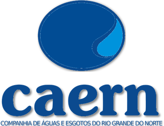

<p align="center">
  
</p>

# CAERN — Home Assistant

[](https://github.com/hudsonbrendon/ha-caern/actions/workflows/tests.yml)
[](https://github.com/hudsonbrendon/ha-caern/actions/workflows/hassfest.yml)
[](https://github.com/hudsonbrendon/ha-caern/actions/workflows/validate.yml)
[](https://github.com/hudsonbrendon/ha-caern/releases)
[](https://github.com/hudsonbrendon/ha-caern/releases)
[](https://hacs.xyz/)
[](https://www.home-assistant.io/)
[](LICENSE)

Integração não-oficial que traz os dados da sua conta de água **CAERN** (Rio
Grande do Norte) para o Home Assistant: contas, consumo (m³), situação de
água/esgoto, faltas d'água/obras e resumo da conta.

Feita por engenharia reversa do app oficial (`br.com.caern.mobile.caernmobile`).
Detalhes do protocolo em [`REVERSE_ENGINEERING.md`](REVERSE_ENGINEERING.md).

> Projeto pessoal, sem vínculo com a CAERN. Use com a sua própria conta.

## Login

O app CAERN usa **Firebase Auth**. Esta integração suporta **login por
e-mail/senha**. Se você entra no app com **Google ou Facebook**, crie uma senha
(ou uma conta e-mail/senha) para usar aqui — contas sociais não funcionam
headless.

## Instalação (HACS)

[](https://my.home-assistant.io/redirect/hacs_repository/?owner=hudsonbrendon&repository=ha-caern&category=integration)
[](https://my.home-assistant.io/redirect/config_flow_start/?domain=caern)

1. HACS → repositórios customizados → `hudsonbrendon/ha-caern` (Integration).
2. Instale "CAERN" e reinicie o Home Assistant.
3. Ajustes → Dispositivos e Serviços → Adicionar Integração → **CAERN**.
4. Informe e-mail e senha do app.

Manual: copie `custom_components/caern` para `config/custom_components/`.

## Entidades (um dispositivo por imóvel/matrícula)

- **Conta atual** — valor em aberto; vencimento, situação, código de barras e
  **PIX copia-e-cola** nos atributos.
- **Consumo medido** (m³) — da conta atual; faturado, média e leituras nos atributos.
- **Consumo (histórico)** — último mês + série completa nos atributos.
- **Situação** — água/esgoto, endereço, autoleitura.
- **Ocorrência / falta d'água** (binary sensor) — ligado quando há obra/falta
  ativa afetando o imóvel, com motivo e previsão de normalização.
- Resumo global: **Contas em aberto**, **Imóveis**, **Registros abertos**.

Atualização a cada 3 h (cloud polling).

## Ações (serviços)

| Serviço | O que faz |
|---|---|
| `caern.enviar_autoleitura` | Envia a leitura do hidrômetro (`matricula`, `leitura`) |
| `caern.adicionar_imovel` | Vincula um imóvel (`matricula` + `cpf_cnpj`) |
| `caern.remover_imovel` | Desvincula um imóvel |
| `caern.segunda_via` | Retorna a 2ª via de uma conta (`id_conta`) |

## Desenvolvimento

```bash
python3 -I tests/test_api.py          # checagens sem HA
CAERN_EMAIL=... CAERN_PASSWORD=... python3 scripts/smoke.py   # login real + dump
```

## Aviso

A API é privada e pode mudar sem aviso. A autoleitura e o vínculo de imóvel
alteram dados na CAERN — confira antes de automatizar.
